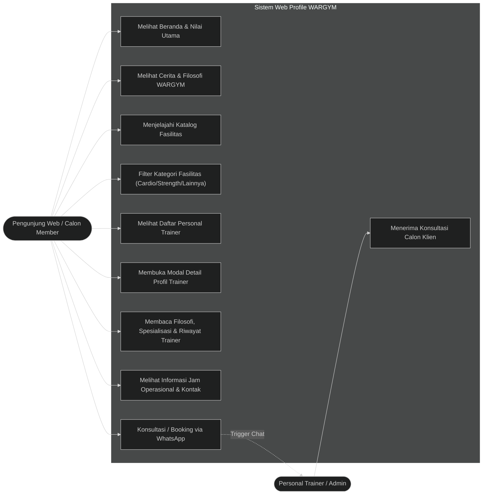
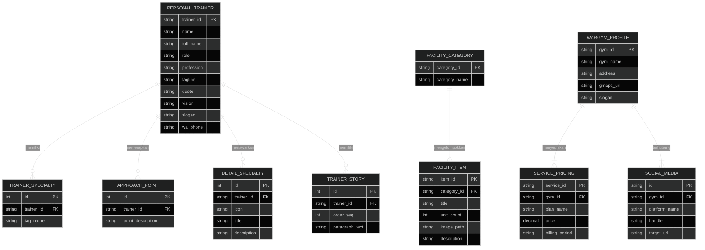
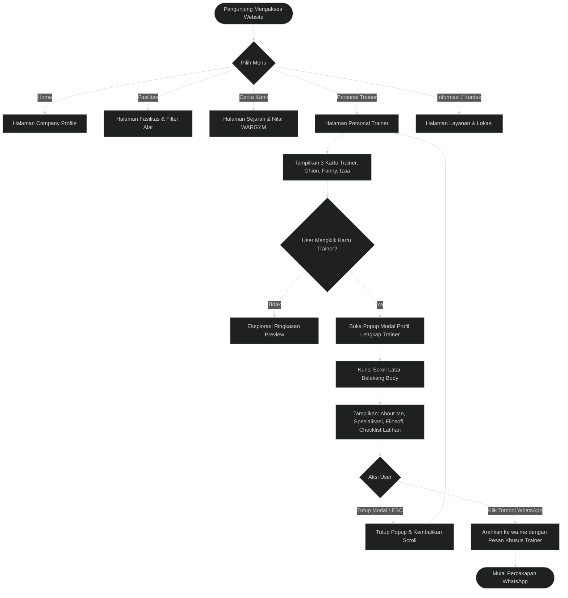
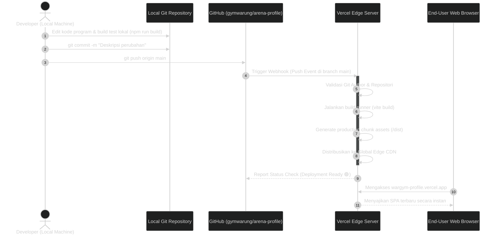

# DOKUMENTASI SISTEM & SPESIFIKASI TEKNIS
## WARGYM MOJOSONGO - WEB APPLICATION COMPANY PROFILE & PERSONAL TRAINING CATALOGUE

---

## DAFTAR ISI
1. [Latar Belakang Sistem](#1-latar-belakang-sistem)
2. [Arsitektur & Tech Stack](#2-arsitektur--tech-stack)
3. [Arsitektur Data & Struktur Entitas](#3-arsitektur-data--struktur-entitas)
4. [Diagram Use Case](#4-diagram-use-case)
5. [Entity Relationship Diagram (ERD)](#5-entity-relationship-diagram-erd)
6. [Alur Kerja Sistem (System Workflow & Flowchart)](#6-alur-kerja-sistem-system-workflow--flowchart)
7. [Riwayat Push GitHub & Log Perbaikan (Changelog)](#7-riwayat-push-github--log-perbaikan-changelog)
8. [Petunjuk Pemeliharaan & Deployment](#8-petunjuk-pemeliharaan--deployment)

---

## 1. LATAR BELAKANG SISTEM

### 1.1 Gambaran Umum Bisnis
**WARGYM (Warung Gym)** adalah pusat kebugaran berbasis komunitas yang berlokasi di Jl. Mojosongo, Diwek, Balong Besuk, Kecamatan Diwek, Kabupaten Jombang, Jawa Timur. WARGYM didirikan dengan visi menghilangkan stigma bahwa gym adalah tempat yang mahal, eksklusif, dan mengintimidasi (*intimidating*). 

Mengadopsi filosofi kehangatan sebuah "Warung", WARGYM dirancang tidak hanya sebagai tempat mengangkat beban, melainkan sebagai wadah sosial: tempat datang untuk berlatih, bertemu orang, saling menyapa, menikmati istirahat, bertukar pengalaman, dan membangun kebiasaan hidup sehat (*longevity & healthy lifestyle*) bersama-sama.

### 1.2 Permasalahan yang Dihadapi (Problem Statement)
Sebelum sistem web profile ini dibangun:
1. **Ketiadaan Informasi Terpusat**: Calon anggota seringkali kesulitan mendapatkan informasi akurat mengenai daftar alat/fasilitas, tarif keanggotaan, dan jam operasional.
2. **Kebutuhan Edukasi Pemula**: Banyak masyarakat (terutama wanita dan pemula) ingin memulai olahraga beban namun merasa minder, ragu cara menggunakan alat, atau takut cedera.
3. **Akses ke Personal Trainer (PT)**: Calon klien memerlukan informasi spesialisasi dan pendekatan masing-masing pelatih (misal: *Healthy Aging/Longevity*, *Women Fitness & Body Recomposition*, atau *Weight Loss & Body Shaping*) sebelum memutuskan untuk mengambil program pelatihan privat.

### 1.3 Solusi Sistem
Sistem web ini dibangun sebagai aplikasi modern berbasis Single Page Application (SPA) yang cepat, interaktif, responsif pada perangkat seluler, serta terintegrasi langsung dengan saluran komunikasi WhatsApp resmi WARGYM. Sistem ini berfungsi sebagai media representasi resmi (*digital presence*), katalog fasilitas interaktif, dan etalase profil personal trainer.

---

## 2. ARSITEKTUR & TECH STACK

Sistem dibangun dengan arsitektur **Client-Side Single Page Application (SPA)** menggunakan ekosistem teknologi modern:

```
+-----------------------------------------------------------------------+
|                             USER CLIENT                               |
|                (Mobile Smartphone, Tablet, Desktop Browser)          |
+-----------------------------------------------------------------------+
                                   |
                                   v  HTTPS Request
+-----------------------------------------------------------------------+
|                       EDGE CDN HOSTING (VERCEL)                       |
|               Auto-Deploy via GitHub Webhook Integration              |
|                     Rewrite: /(.*) -> /index.html                     |
+-----------------------------------------------------------------------+
                                   |
                                   v  Distribusi Asset
+-----------------------------------------------------------------------+
|                         VUE 3 SPA APPLICATION                         |
|  +-----------------------------------------------------------------+  |
|  | Vue Router 4 (HTML5 History Mode, Dynamic Metadata, SmoothNav) |  |
|  +-----------------------------------------------------------------+  |
|  | View Components:                                                |  |
|  | - CompanyProfile.vue   - Fasilitas.vue       - Team.vue         |  |
|  | - PersonalTrainer.vue  - Informasi.vue       - Contact.vue      |  |
|  +-----------------------------------------------------------------+  |
|  | Styling & UI Layer:                                             |  |
|  | - Tailwind CSS JIT Runtime Theme                                |  |
|  | - Vanilla CSS (Metal Grid, Glassmorphism, Custom Scrollbars)    |  |
|  | - Google Fonts (Oswald, Hanken Grotesk, JetBrains Mono)         |  |
|  | - Google Material Symbols                                       |  |
|  +-----------------------------------------------------------------+  |
|  | In-Memory Data Store (Trainers, Facilities, Services, Stories) |  |
+-----------------------------------------------------------------------+
                                   |
                                   v  Action Links
+-----------------------------------------------------------------------+
|                    EXTERNAL APIS & INTEGRATIONS                       |
|  - WhatsApp Business API Gateway (wa.me click-to-chat dynamic URL)    |
|  - Google Maps Location Embed                                         |
|  - Social Media Links (TikTok, Instagram)                             |
+-----------------------------------------------------------------------+
```

### Rincian Teknologi:
| Komponen | Teknologi | Deskripsi |
| :--- | :--- | :--- |
| **Frontend Framework** | **Vue.js 3.5+** | Menggunakan *Composition API* (`<script setup>`) untuk modularitas kode, reaktivitas efisien, dan performa tinggi. |
| **Build Tool & Bundler** | **Vite 8** | Menyediakan *Hot Module Replacement* (HMR) berkecepatan tinggi saat development dan optimasi bundel tree-shaking saat produksi. |
| **Routing Manager** | **Vue Router 4** | Mengelola navigasi halaman dinamis tanpa reload halaman (*client-side routing*), dengan dynamic meta titles dan scroll behavior. |
| **Styling & CSS** | **Tailwind CSS + Custom CSS** | Konfigurasi tema warna industrial gelap (*Dark Luxury Gym Theme*): `#131313` background, `#ff5540` brand-red, dan komponen kaca transparan (*Glassmorphism*). |
| **Typography & Ikon** | **Google Fonts & Symbols** | Font *Oswald* (Headline), *Hanken Grotesk* (Body), *JetBrains Mono* (Labels/Badges), serta *Material Symbols Outlined*. |
| **Data Storage** | **Client-Side Reactive Store** | Data terstruktur disimpan secara in-memory dalam model objek JavaScript reaktif, memastikan waktu muat instan tanpa dependensi database eksternal yang berat. |
| **Deployment & CI/CD** | **Vercel Edge Platform** | Integrasi webhook otomatis dengan repositori GitHub `gymwarung/arena-profile` untuk continuous deployment otomatis. |

---

## 3. ARSITEKTUR DATA & STRUKTUR ENTITAS

Aplikasi ini menggunakan pendekatan **Decoupled Data Modeling** yang terstruktur. Entitas utama didesain untuk merepresentasikan objek bisnis gym secara terperinci.

### 3.1 Model Entitas Personal Trainer (`Trainer`)
Model ini mengelola seluruh informasi profil pelatih kebugaran yang ditampilkan pada kartu dan popup modal:

```typescript
interface PersonalTrainer {
  name: string;               // Nama panggilan (misal: "GHION", "FANNY", "IZAA")
  fullName: string;           // Nama lengkap / title resmi (misal: "Coach Fanny", "Kak Izaa")
  age?: number;               // Usia (opsional)
  profession: string;         // Jabatan profesional (misal: "Personal Trainer / Fitness Coach")
  role?: string;              // Peran spesifik (misal: "Women Personal Trainer")
  tagline?: string;           // Slogan singkat (misal: "Beginner Friendly Women Fitness")
  specialties: string[];      // Array tags keahlian untuk badge preview
  previewDesc: string;        // Ringkasan untuk preview pada kartu depan (line-clamp-3)
  quote: string;              // Kutipan filosofi pelatih
  quoteSub?: string;          // Penjelasan tambahan kutipan
  desc?: string;              // Uraian pendekatan program latihan
  aboutMe?: string[];         // Paragraf narasi latar belakang dan cerita pelatih
  detailedSpecialties?: {     // Spesialisasi detail dengan ikon & deskripsi
    icon: string;
    title: string;
    desc: string;
  }[];
  approachPoints?: string[];  // Poin-poin metode pendekatan latihan (checklist)
  focusPoints?: string[];     // Fokus latihan untuk pemula
  vision?: string;            // Visi kepelatihan
  mottos?: string[];          // Slogan singkat pendukung
  slogan: string;             // Slogan utama penutup
  waMessageText: string;      // Teks default saat calon member mengklik tombol WhatsApp
}
```

### 3.2 Model Entitas Fasilitas (`Facility`)
```typescript
interface Facility {
  id: string;
  name: string;
  category: 'cardio' | 'strength' | 'lainnya';
  count: number;
  image: string;
  description: string;
}
```

### 3.3 Model Entitas Informasi & Layanan (`ServicePlan`)
```typescript
interface ServicePlan {
  id: string;
  name: string;
  category: 'membership' | 'daily' | 'pt_session';
  price: number;
  period: string;
  benefits: string[];
}
```

---

## 4. DIAGRAM USE CASE

Diagram use case berikut memodelkan seluruh interaksi antara aktor (Pengunjung Web / Calon Member dan Personal Trainer) dengan modul-modul sistem:



---

## 5. ENTITY RELATIONSHIP DIAGRAM (ERD)

Meskipun sistem beroperasi secara *Client-Side Store*, arsitektur data internal terelasi secara konseptual sebagai berikut:



---

## 6. ALUR KERJA SISTEM (SYSTEM WORKFLOW & FLOWCHART)

### 6.1 Alur Navigasi & Eksplorasi Profil Personal Trainer



### 6.2 Alur Otomatisasi CI/CD Deployment (Vercel Integration)



---

## 7. RIWAYAT PUSH GITHUB & LOG PERBAIKAN (CHANGELOG)

Berikut adalah catatan historis perubahan repositori resmi yang tercatat di cabang `main`:

| No | Commit Hash | Tanggal & Waktu (WIB) | Kontributor | Ringkasan Commit | Detail Perbaikan & Dampak Sistem |
| :---: | :---: | :---: | :---: | :--- | :--- |
| **21** | `1560c0a` | 2026-10-23 15:18:44 | `gymwarung` | **Dokumentasi teknis sistem lengkap (DOCUMENTATION.md)** | Pembuatan berkas dokumentasi sistem komprehensif mencakup latar belakang bisnis, arsitektur & tech stack, schema data model, Use Case diagram, ERD, flowchart alur sistem, sequence diagram CI/CD, dan changelog push GitHub. |
| **20** | `5180352` | 2026-10-23 14:09:14 | `gymwarung` | **Tambah card personal trainer Kak Izaa beserta modal profil lengkap** | Menambahkan profil pelatih ke-3 (Kak Izaa) dengan spesialisasi *Weight Loss, Body Shaping, Fitness, & Healthy Lifestyle*. Memperluas grid kartu personal trainer menjadi 3 kolom simetris pada layar desktop (`lg:grid-cols-3`). Menyediakan modal popup lengkap dengan filosofi, visi, dan integrasi WhatsApp. |
| **19** | `6b86d28` | 2026-10-23 10:58:45 | `gymwarung` | **Trigger deploy update card fanny** | Mengirimkan trigger build otomatis ke Vercel setelah repositori baru `gymwarung/arena-profile` terhubung, memperbarui aset live production. |
| **18** | `e3daca3` | 2026-10-23 10:28:27 | `gymwarung` | **Card fanny & Sinkronisasi Author** | Memperbarui kartu Coach Fanny agar berpenampilan simetris dengan kartu Kak Ghion (menggunakan format *line-clamp-3* pada cerita About Me). Menyinkronkan identitas commit author ke `gymwarung <gymwarung@gmail.com>` serta memperbarui `package-lock.json` (`wargym-profile`). |
| **17** | `e829190` | 2026-10-05 15:41:48 | `musyafak-a` | **Ganti gambar fasilitas Smith Machine dan Chest Press dengan aset lokal** | Mengalihkan ketergantungan tautan eksternal gambar alat Smith Machine dan Chest Press ke file aset lokal di `/public/images/` untuk kecepatan muat dan stabilitas tampilan. |
| **16** | `322ba56` | 2026-10-05 15:02:49 | `musyafak-a` | **PERBAIKAN PT** | Penataan tata letak layout dan penyempurnaan padding pada section profil personal trainer. |
| **15** | `81a76bf` | 2026-10-05 14:57:51 | `musyafak-a` | **Hapus tombol WhatsApp di samping tombol Tutup pada footer popup modal PT** | Merapikan footer modal agar tombol Tutup berdiri bersih di sudut kanan bawah dan tombol CTA utama difokuskan di bagian banner bawah modal body. |
| **14** | `93d61aa` | 2026-10-05 14:47:40 | `musyafak-a` | **Hapus badge usia/role dan ikon dumbbell di kedua card personal trainer** | Mengeliminasi elemen badge yang kurang relevan di kartu utama agar desain lebih minimalis, elegan, dan fokus pada nama serta tag keahlian. |
| **13** | `e662abc` | 2026-10-05 11:50:14 | `musyafak-a` | **Buat kedua card personal trainer (Ghion & Fanny) text-only tanpa foto** | Standardisasi tampilan kartu pelatih berbasis tipografi kuat (*text-only aesthetic*) berlatar belakang kaca (*glass-panel*) agar tampilan seimbang tanpa foto placeholder. |
| **12** | `ff649a8` | 2026-10-05 11:33:42 | `musyafak-a` | **Update card trainer Dika menjadi Fanny dengan deskripsi menyusul** | Pergantian data trainer dari Dika ke Coach Fanny pada struktur data trainer. |
| **11** | `c0411d6` | 2026-10-05 11:25:27 | `musyafak-a` | **Update card Ghion dengan preview dan popup modal profil lengkap** | Implementasi modal interaktif untuk Coach Ghion yang memuat perjalanan mengatasi autoimun, spesialisasi kebugaran longevity, prinsip latihan, dan visi kepelatihan. |
| **10** | `330cc05` | 2026-10-05 10:36:12 | `musyafak-a` | **Update gambar card fasilitas** | Integrasi gambar lokal fasilitas pendukung: Musholla (`musholla.jpeg`), Warung Kopi (`warung.jpg`), Samsak Tinju (`samsak.png`), dan Kipas Angin (`kipas.png`). |
| **9** | `5994a9b` | 2026-10-05 10:17:50 | `musyafak-a` | **Sesuaikan dan tambahkan fasilitas baru** | Pemutakhiran daftar inventaris alat: Abductor + Adductor (1 unit), Kamar Mandi/Toilet, Musholla, Free Wi-Fi, dan Sirkulasi Udara Kipas Angin. |
| **8** | `44605a3` | 2026-10-05 10:03:52 | `musyafak-a` | **Update deskripsi Cerita Kami dengan profil lengkap WARGYM Mojosongo** | Penulisan narasi otentik pada halaman `Team.vue` tentang asal-usul nama WARGYM (Warung Gym), visi kebersamaan, dan prinsip *sehat tidak harus mahal*. |
| **7** | `abc9d2c` | 2026-10-05 09:57:21 | `musyafak-a` | **Update halaman PT: sisakan 2 card** | Restrukturisasi awal halaman Personal Trainer untuk fokus pada 2 pelatih utama. |
| **6** | `a75783d` | 2026-10-03 13:12:59 | `musyafak-a` | **Hapus gambar & referensi logo lama, ganti favicon ke WARGYM** | Pembersihan aset lama (*branding cleanup*), penggantian logo dan favicon resmi WARGYM SVG. |
| **5** | `c684089` | 2026-10-03 12:52:12 | `musyafak-a` | **Update nomor WhatsApp resmi** | Pengalihan nomor kontak di seluruh komponen web ke nomor resmi pengelola: `+62 895-0836-6293`. |
| **4** | `ff6546b` | 2026-10-03 12:36:01 | `musyafak-a` | **isi** | Penyempurnaan konten teks dan metadata dasar halaman. |
| **3** | `fae7bda` | 2026-10-03 12:21:37 | `musyafak-a` | **first commit** | Inisiasi struktur repositori awal pasca migrasi. |
| **2** | `0c92905` | 2026-10-02 14:59:00 | `musyafak-a` | **docs: update README with deployment and project guide** | Dokumentasi instruksi setup lokal, script npm, dan konfigurasi build. |
| **1** | `bb1139a` | 2026-10-02 14:57:47 | `musyafak-a` | **Initial commit: Migrasi company profile WARGYM ke Vue 3 + Vite** | Migrasi arsitektur dasar website dari format statis lama ke arsitektur Single Page Application berbasis Vue 3 dan Vite. |

---

## 8. PETUNJUK PEMELIHARAAN & DEPLOYMENT

### 8.1 Menjalankan di Lingkungan Lokal (Local Development)
Pastikan lingkungan telah terpasang **Node.js v20.x atau lebih tinggi**:

```bash
# 1. Masuk ke direktori project
cd c:\laragon\www\arenafitness-profile

# 2. Pasang dependensi jika belum ada
npm install

# 3. Jalankan development server
npm run dev
```
Aplikasi lokal akan berjalan di `http://localhost:5173/`.

### 8.2 Melakukan Validasi Build Produksi
Sebelum melakukan push ke GitHub, selalu pastikan build bundle bebas error:
```bash
npm run build
```
Hasil build akan terkompilasi ke dalam folder `/dist/`.

### 8.3 Prosedur Rilis & Push ke GitHub
Setiap commit baru yang didorong ke branch `main` pada repositori `https://github.com/gymwarung/arena-profile.git` akan secara otomatis memicu proses build di Vercel:

```bash
# Menambahkan perubahan
git add .

# Membuat commit terstruktur
git commit -m "Deskripsi fitur atau perbaikan"

# Mendorong perubahan ke GitHub
git push origin main
```
Deployment live dapat dipantau langsung di: **[https://wargym-profile.vercel.app](https://wargym-profile.vercel.app)**.

---
*Dokumentasi ini disusun secara komprehensif untuk kebutuhan pemeliharaan teknis, audit sistem, dan pengembangan lanjutan aplikasi web WARGYM Mojosongo.*
