# Database Entity Relationship Diagram (ERD) - Arena Fitness (WARGYM)

Dokumen ini memuat arsitektur database lengkap aplikasi **Arena Fitness** yang dibangun di atas framework Laravel dengan database MySQL.

---

## 1. Visualisasi ERD (Mermaid)

> **Tips Melihat Diagram:**
> - Di VS Code / Antigravity IDE: Tekan `Ctrl + Shift + V` untuk membuka **Markdown Preview**.
> - Di Browser: Buka file interaktif [database_diagram.html](../database_diagram.html) atau akses lewat Laragon `http://arenafitness.test/database_diagram.html`.

```mermaid
erDiagram
    %% Auth & User Management
    users ||--o| members : "user_id (1 to 0..1)"
    users ||--o{ transactions : "cashier_user_id"
    users ||--o{ checkins : "verified_by"
    users ||--o{ product_stock_logs : "user_id"
    users ||--o{ membership_renewal_requests : "reviewed_by"
    users ||--o{ profile_photo_change_requests : "reviewed_by"
    users ||--o{ member_feedbacks : "user_id"
    users ||--o{ sessions : "user_id"

    %% Membership & Subscriptions
    members ||--o{ membership_subscriptions : "member_id"
    membership_plans ||--o{ membership_subscriptions : "membership_plan_id"
    members ||--o{ membership_renewal_requests : "member_id"
    membership_plans ||--o{ membership_renewal_requests : "membership_plan_id"
    members ||--o{ profile_photo_change_requests : "member_id"
    members ||--o{ member_feedbacks : "member_id"

    %% Presensi & Checkin
    members ||--o{ checkins : "member_id"
    daily_guests ||--o{ checkins : "daily_guest_id"

    %% Point of Sale (POS) & Transaksi
    members ||--o{ transactions : "member_id"
    daily_guests ||--o{ transactions : "daily_guest_id"
    transactions ||--|{ transaction_items : "transaction_id"

    %% Produk & Inventaris
    categories ||--o{ products : "category_id"
    products ||--o{ transaction_items : "product_id"
    products ||--o{ product_stock_logs : "product_id"

    %% Definisi Entitas & Kolom
    users {
        bigint id PK
        string name
        string login UK
        string email UK
        string role "admin, master_admin, cashier, member"
        string password
        timestamp email_verified_at
        string remember_token
        timestamps created_at_updated_at
    }

    sessions {
        string id PK
        bigint user_id FK
        string ip_address
        text user_agent
        longtext payload
        integer last_activity
    }

    members {
        bigint id PK
        bigint user_id FK "nullable, unique"
        string full_name
        string email UK "nullable"
        string phone "nullable"
        string checkin_code UK "nullable"
        string profile_photo_path "nullable"
        tinyint profile_photo_change_count
        date joined_at "nullable"
        date expires_at "nullable"
        timestamp last_membership_reminder_at "nullable"
        text notes "nullable"
        timestamps created_at_updated_at
    }

    membership_plans {
        bigint id PK
        string name UK
        tinyint duration_months
        integer price
        text description "nullable"
        boolean is_active
        timestamps created_at_updated_at
    }

    membership_subscriptions {
        bigint id PK
        bigint member_id FK
        bigint membership_plan_id FK
        date start_date
        date end_date
        integer amount_paid
        string payment_method "cash, qris, transfer"
        string status "active, expired, cancelled"
        timestamps created_at_updated_at
    }

    daily_guests {
        bigint id PK
        string full_name
        string phone "nullable"
        string visit_type "reguler, event, dll"
        timestamp visit_at
        timestamps created_at_updated_at
    }

    categories {
        bigint id PK
        string name UK
        text description "nullable"
        timestamps created_at_updated_at
    }

    products {
        bigint id PK
        bigint category_id FK "nullable"
        string name
        string brand "nullable"
        string sku UK "nullable"
        integer price
        integer stock
        string unit "pcs, botol, sachet"
        text description "nullable"
        boolean is_active
        timestamps created_at_updated_at
    }

    product_stock_logs {
        bigint id PK
        bigint product_id FK
        enum type "in, out, adjustment"
        integer quantity
        string description "nullable"
        string reference_id "nullable"
        bigint user_id FK "nullable"
        timestamps created_at_updated_at
    }

    transactions {
        bigint id PK
        string invoice UK
        string snap_token "nullable (Midtrans)"
        bigint member_id FK "nullable"
        bigint daily_guest_id FK "nullable"
        bigint cashier_user_id FK "nullable"
        string type "membership_payment, daily_pass, product_sale, other"
        string customer_name "nullable"
        string description "nullable"
        integer amount
        integer paid_amount "nullable"
        integer change_amount "nullable"
        string payment_method "nullable"
        string payment_status "pending, verified, cancelled"
        timestamp transaction_at
        text notes "nullable"
        timestamps created_at_updated_at
    }

    transaction_items {
        bigint id PK
        bigint transaction_id FK
        bigint product_id FK "nullable"
        string item_name
        integer quantity
        integer unit_price
        integer subtotal
        timestamps created_at_updated_at
    }

    checkins {
        bigint id PK
        bigint member_id FK "nullable"
        bigint daily_guest_id FK "nullable"
        timestamp checked_in_at
        string checkin_method "admin, qr_code, self_service"
        string verification_status "pending, verified, rejected"
        string submitted_name "nullable"
        string submitted_phone "nullable"
        timestamp verified_at "nullable"
        bigint verified_by FK "nullable"
        text notes "nullable"
        timestamps created_at_updated_at
    }

    expense_records {
        bigint id PK
        string title
        string category "nullable"
        integer amount
        string payment_method "default: cash"
        date expense_date
        text notes "nullable"
        timestamps created_at_updated_at
    }

    announcements {
        bigint id PK
        string title
        text body
        string status "draft, published, archived"
        timestamp publish_at "nullable"
        timestamp archived_at "nullable"
        timestamps created_at_updated_at
    }

    member_feedbacks {
        bigint id PK
        bigint user_id FK "nullable"
        bigint member_id FK "nullable"
        string name
        string email "nullable"
        string subject
        text message
        timestamp read_at "nullable"
        timestamps created_at_updated_at
    }

    membership_renewal_requests {
        bigint id PK
        bigint member_id FK
        bigint user_id FK "nullable"
        bigint membership_plan_id FK "nullable"
        integer amount
        string payment_method
        string payment_proof_path "nullable"
        string status "pending, approved, rejected"
        timestamp requested_at "nullable"
        timestamp reviewed_at "nullable"
        bigint reviewed_by FK "nullable"
        timestamps created_at_updated_at
    }

    profile_photo_change_requests {
        bigint id PK
        bigint user_id FK "nullable"
        bigint member_id FK
        string requested_photo_path
        string status "pending, approved, rejected"
        timestamp reviewed_at "nullable"
        bigint reviewed_by FK "nullable"
        timestamps created_at_updated_at
    }
```

---

## 2. Deskripsi Modul & Tabel

| Modul | Tabel | Model Terkait | Fungsi Utama |
|---|---|---|---|
| **Auth & User** | `users` | `User` | Kredensial login, peran pengguna (`admin`, `master_admin`, `cashier`, `member`) |
| | `sessions` | - | Session aktif browser pengguna |
| | `password_reset_tokens` | - | Token reset kata sandi |
| **Membership** | `members` | `Member` | Data profil anggota, tanggal expired, kode check-in unik QR |
| | `membership_plans` | `MembershipPlan` | Master paket langganan (Bulanan, 3 Bulan, dll.) |
| | `membership_subscriptions` | `MembershipSubscription` | Riwayat transaksi langganan dan status keaktifan |
| | `daily_guests` | `DailyGuest` | Pengunjung harian non-member (Daily Pass) |
| **Presensi** | `checkins` | `Checkin` | Log kehadiran member dan tamu harian, metode checkin, serta verifikator |
| **POS & Inventaris** | `categories` | `Category` | Kategori produk suplemen / minuman / aksesoris |
| | `products` | `Product` | Data stok, harga, dan SKU barang |
| | `product_stock_logs` | `ProductStockLog` | Mutasi stok barang (masuk, keluar, penyesuaian) |
| | `transactions` | `Transaction` | Transaksi kasir (membership, daily pass, belanja produk) + Midtrans snap token |
| | `transaction_items` | `TransactionItem` | Detail baris barang belanjaan dalam transaksi |
| **Operasional** | `expense_records` | `ExpenseRecord` | Catatan pengeluaran operasional gym harian/bulanan |
| **Layanan Member**| `announcements` | `Announcement` | Pengumuman broadcast untuk member gym |
| | `member_feedbacks` | `MemberFeedback` | Kotak saran dan pesan dari member ke pengelola |
| | `membership_renewal_requests` | `MembershipRenewalRequest` | Permintaan perpanjangan membership mandiri lewat portal member |
| | `profile_photo_change_requests` | `ProfilePhotoChangeRequest` | Permintaan ganti foto profil member dengan verifikasi admin |
